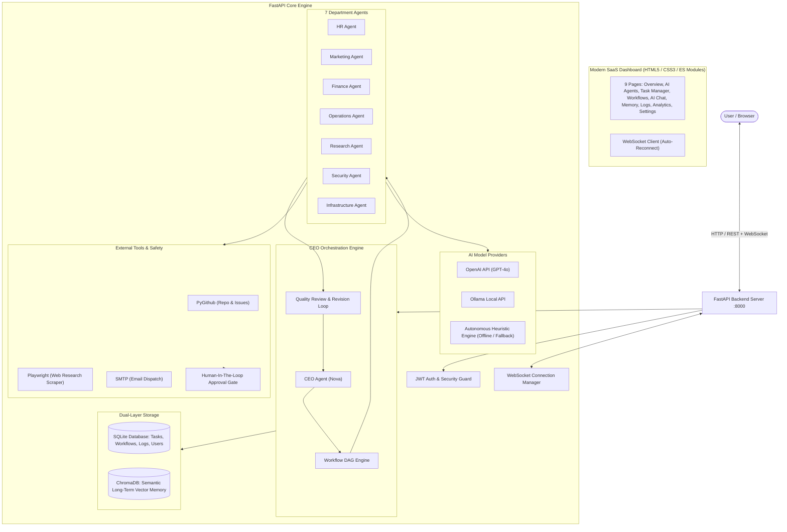

# AI ECOSYSTEM — Multi-Agent AI Business Operating System

> A production-ready virtual enterprise platform where a central **CEO Agent** collaborates with **7 specialized department agents** (HR, Marketing, Finance, Operations, Research, Security, Infrastructure) to autonomously plan, execute, critique, revise, and consolidate complex business objectives.

---

## 🌟 Executive Highlights

- **8 Specialized Department Agents**: Each with dedicated system instructions, analytical reasoning, persistent memory, and operational capabilities.
- **CEO Multi-Agent Orchestrator**: Parses high-level corporate goals, generates dependency-directed acyclic graphs (DAGs), delegates subtasks, critiques intermediate outputs, requests revisions, and compiles consolidated executive decisions.
- **Dual-Layer Memory Architecture**: Relational **SQLite** for operational state, logs, and audit trails; **ChromaDB** for vector-based semantic memory and long-term organizational recall.
- **Real-Time Telemetry**: Bidirectional **WebSockets** live-streaming agent thinking states, inter-agent dialogue, task transitions, and notification alerts.
- **Human-In-The-Loop Safety Gating**: Sensitive actions (SMTP email dispatch, GitHub modifications) enter `Awaiting Approval` state, requiring operator sign-off before execution.
- **Modern SaaS Dashboard**: Linear/Vercel/OpenAI-inspired dark design system with 9 responsive pages, interactive charts (Chart.js), and native HTML5/CSS3/ES modules.
- **Triple-Tier LLM Support**: Seamlessly connects to **OpenAI** (`gpt-4o`, `gpt-4o-mini`), **Ollama** (offline local models like `llama3`), and an intelligent **Autonomous Heuristic Fallback Engine** that works immediately without API keys.

---

## 🏢 The 8 AI Department Agents

| Agent | Name | Department | Primary Responsibilities | Specialized Capabilities |
| :--- | :--- | :--- | :--- | :--- |
| 👑 **CEO** | Nova | Executive Leadership | Strategic planning, goal breakdown, delegation, output critique, revision loop, executive synthesis | Multi-agent DAG planner, critique engine, consolidated decision maker |
| 👥 **HR** | Marcus | Human Resources | Workforce planning, hiring profiles, team capacity balancing, labor guidelines, performance rubrics | Role specification, team workload balancing, hiring funnel design |
| 📢 **Marketing** | Chloe | Marketing & Growth | GTM roadmaps, customer acquisition, copywriting, social media schedules, SEO, positioning | Multi-channel campaigns, creative briefs, audience demographic segmentation |
| 💰 **Finance** | Sterling | Finance & Economics | Line-item budget modeling, unit economics (CAC, LTV, AOV), breakeven projections, cashflow audits | Zero-deficit budget allocation, ROI forecasting, risk controls |
| ⚙️ **Operations** | Atlas | Business Operations | Supply chain logistics, SOP formulation, vendor management, milestone tracking, quality SLAs | Fulfillment mapping, logistics handoffs, bottleneck mitigation |
| 🔬 **Research** | Athena | Market Intelligence | Competitor benchmarking, industry trends, consumer sentiment, web intelligence | Playwright web research, market sizing, threat matrix |
| 🛡️ **Security** | Vigil | InfoSec & Compliance | Cyber threat modeling, PCI-DSS & GDPR compliance, vulnerability audits, action authorization | Secret leak detection, action gating, access control |
| 🖥️ **Infrastructure**| Forge | DevOps & Platform | Container specs (Docker), CI/CD pipelines, repository management via PyGithub, cloud scaling | Dockerfile generation, GitHub issue/PR management, system health |

---

## 🗺️ System Architecture



---

## 📱 Dashboard Pages (9 Views)

1. **Executive Overview**: High-level KPIs (active workflows, completed tasks, queue depth), active agent status carousel, and live activity log stream.
2. **AI Agents**: Complete directory of all 8 department agents with status pills, completed task counters, capabilities tags, and a slide-over panel for **1-on-1 Direct Dialogue**.
3. **Task Manager**: Interactive Kanban board (Pending, Running, Awaiting Approval, Completed, Failed/Cancelled) with department filtering, task creation modal, execution logs, and Approve/Reject buttons.
4. **Workflows**: Visual interactive workflow pipeline showing multi-agent DAGs, milestone progress bars, intermediate department outputs, and the CEO consolidated synthesis.
5. **CEO AI Chat**: Natural language conversational interface with CEO Nova. Understands complex corporate goals, decomposes them, and mobilizes departments with real-time feedback.
6. **Vector Memory**: Semantic knowledge base powered by ChromaDB. Perform vector queries, inspect distance scores, and index corporate documents or policy manuals.
7. **Activity Logs**: Streaming terminal log of all inter-agent messages, system actions, status transitions, and audit records with severity filters (`INFO`, `ACTION`, `SUCCESS`, `WARN`, `ERROR`).
8. **Analytics**: Interactive Chart.js visual metrics (workload by department doughnut chart, agent task throughput bar chart, and department productivity leaderboard).
9. **Settings**: LLM Provider switcher (OpenAI vs. Ollama vs. Heuristic), API key inputs, integration credentials (GitHub, SMTP), and security approval policy toggles.

---

## 🚀 Quickstart & Installation

### Prerequisites
- Python 3.12+
- Git
- Docker (optional for containerized deployment)

### 1. Clone & Set Up Virtual Environment

```bash
cd manananna

# Create Python 3.12 virtual environment
python3 -m venv .venv
source .venv/bin/activate

# Install dependencies
pip install -r requirements.txt
```

### 2. Configure Environment

```bash
cp .env.example .env
```

Edit `.env` to configure your preferred AI provider:
- To use **OpenAI**: Set `DEFAULT_LLM_PROVIDER=openai` and add `OPENAI_API_KEY=sk-...`
- To use **Ollama**: Set `DEFAULT_LLM_PROVIDER=ollama` and ensure Ollama is running at `http://localhost:11434`
- To use **Offline Heuristic Mode**: Set `DEFAULT_LLM_PROVIDER=heuristic` (requires zero keys or setup!)

### 3. Start the Application

```bash
# Start backend server with static frontend hosting
uvicorn backend.main:app --host 0.0.0.0 --port 8000 --reload
```

Open your browser at:
👉 **`http://localhost:8000`**

Default Administrator Account (pre-seeded):
- **Email**: `admin@aiecosystem.internal`
- **Password**: `admin123456`

---

## 🧪 Testing & Verification

The codebase includes an automated test suite covering authentication, all 8 agents, task lifecycles, CEO orchestration DAGs, vector memory search, and external integrations.

```bash
# Run complete test suite
.venv/bin/pytest tests/ -v
```

Output:
```
tests/test_agents.py::test_all_eight_agents_exist PASSED
tests/test_agents.py::test_direct_agent_chat PASSED
tests/test_agents.py::test_agent_history PASSED
tests/test_auth.py::test_register_and_login PASSED
tests/test_integrations.py::test_github_integration PASSED
tests/test_integrations.py::test_playwright_scrape PASSED
tests/test_integrations.py::test_email_dispatch PASSED
tests/test_memory.py::test_memory_indexing_and_search PASSED
tests/test_orchestrator.py::test_ceo_orchestration_workflow PASSED
tests/test_tasks.py::test_task_lifecycle_and_approval PASSED

======================== 10 passed in 4.12s ========================
```

---

## 🐳 Docker Deployment

### Run with Docker Compose

```bash
# Build and run containers
docker-compose up --build -d

# Check logs
docker-compose logs -f
```

The application will be live at `http://localhost:8000` with persistent data stored in `./data`.

---

## 🛡️ Consequential Action Approval Protocol

By default, any task involving consequential external actions (such as sending emails via SMTP or modifying code/issues via GitHub) will transition into the `Awaiting Approval` status in the Task Manager.

1. The CEO assigns the sensitive subtask.
2. The system pauses execution of that specific task and broadcasts an `APPROVAL_REQUIRED` event over WebSockets.
3. The dashboard highlights the task with an amber border and displays **"Authorize & Run Action"** and **"Reject Action"** buttons.
4. Once authorized by the operator, the agent resumes execution.

---

## 📄 License & Credits

Built as part of the **AI ECOSYSTEM: Multi-Agent AI Business Operating System** initiative.
Designed with inspiration from Linear, Vercel, and modern enterprise software architecture.
